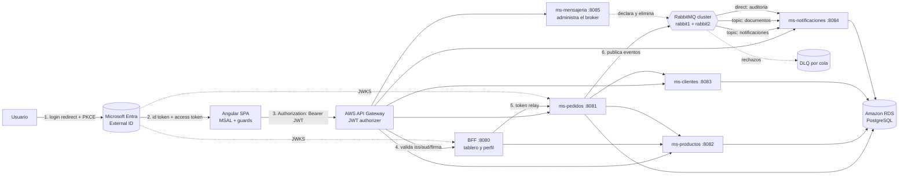
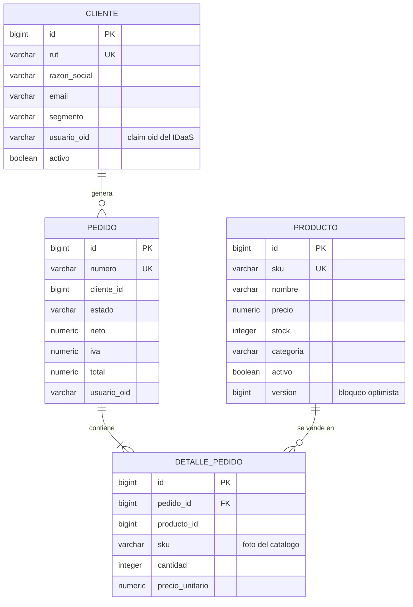
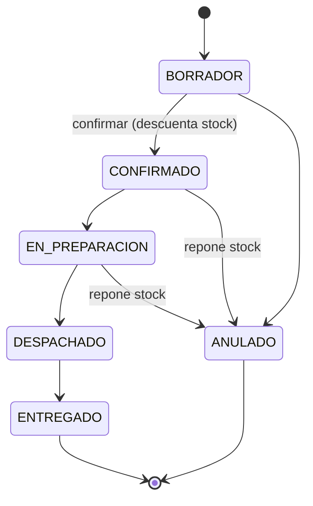

# Arquitectura de Pedidos360

## Vista general

El detalle de la mensajeria esta en [08-mensajeria-rabbitmq.md](08-mensajeria-rabbitmq.md).

## Por que el token se valida tres veces

| Capa | Que valida | Que pasa si falla |
|---|---|---|
| API Gateway (JWT authorizer) | firma, `iss`, `aud`, vigencia | 401 antes de entrar a la VPC |
| Microservicio de destino | firma, `iss`, `aud`, `tid`, `scp`, vigencia + rol del endpoint | 401 / 403 con Problem Detail |
| Microservicio llamado por otro | lo mismo, sobre el token reenviado | 401 / 403 |

No es redundancia inutil: si alguien alcanza una instancia EC2 sin pasar por el gateway
(por ejemplo desde dentro de la VPC), igual necesita un token valido. Ningun servicio
confia en que "alguien antes ya lo reviso".

## Componentes

### Frontend — `pedidos360-frontend`

| Pieza | Archivo | Rol |
|---|---|---|
| Configuracion MSAL | `core/auth/msal.config.ts` | instancia, guard e interceptor |
| Estado de sesion | `core/auth/auth.service.ts` | cuenta activa, roles y scopes desde los claims |
| Guard de rol | `core/auth/role.guard.ts` | corta la navegacion si falta el rol |
| Cliente HTTP | `core/services/pedidos360-api.service.ts` | unica salida hacia el API Gateway |
| Manejo de errores | `core/interceptors/error.interceptor.ts` | traduce 401/403/409 a avisos |

### Backend — `pedidos360-backend`

| Modulo | Puerto | Responsabilidad |
|---|---|---|
| `pedidos360-common-security` | — | validacion de JWT, roles, CORS y Problem Detail compartidos |
| `pedidos360-common-messaging` | — | topologia de RabbitMQ, publicador de eventos y politica de ACK |
| `bff-service` | 8080 | vistas agregadas (`tablero`) e identidad (`perfil`) |
| `ms-pedidos` | 8081 | pedidos, detalle y maquina de estados |
| `ms-productos` | 8082 | catalogo y control de stock |
| `ms-clientes` | 8083 | fichas de clientes y direcciones |
| `ms-notificaciones` | 8084 | consume los eventos: avisos al cliente y tickets de pedidos |
| `ms-mensajeria` | 8085 | administra colas, exchanges y bindings del broker |

## Modelo de datos

Cada microservicio es duenio de sus tablas (*database per service*): `ms-pedidos` guarda el
`cliente_id` y el `producto_id`, pero nunca hace `JOIN` contra las tablas de los otros
servicios; consulta sus APIs reenviando el token del usuario.

## Ciclo de vida del pedido

Cualquier otra transicion se rechaza con **409 Conflict** y el mensaje explica el porque.

## Autorizacion por rol

| Endpoint | `Pedidos.Admin` | `Pedidos.Vendedor` | `Pedidos.Cliente` |
|---|:---:|:---:|:---:|
| `GET /api/v1/productos` | si | si | si |
| `POST /api/v1/productos` | si | no | no |
| `DELETE /api/v1/productos/{id}` | si | no | no |
| `GET /api/v1/clientes` | si | si | no |
| `GET /api/v1/clientes/mi-ficha` | si | si | si |
| `GET /api/v1/pedidos` | si | si | no |
| `POST /api/v1/pedidos` | si | si | no |
| `PUT /api/v1/pedidos/{id}/anular` | si | no | no |
| `GET /api/v1/pedidos/mis-pedidos` | si | si | si |
| `GET /api/bff/tablero` | si | si | no |
| `GET /api/bff/perfil` | si | si | si |

El frontend usa esta misma tabla para ocultar acciones, pero **quien decide es el backend**:
esconder un boton no es un control de seguridad.
